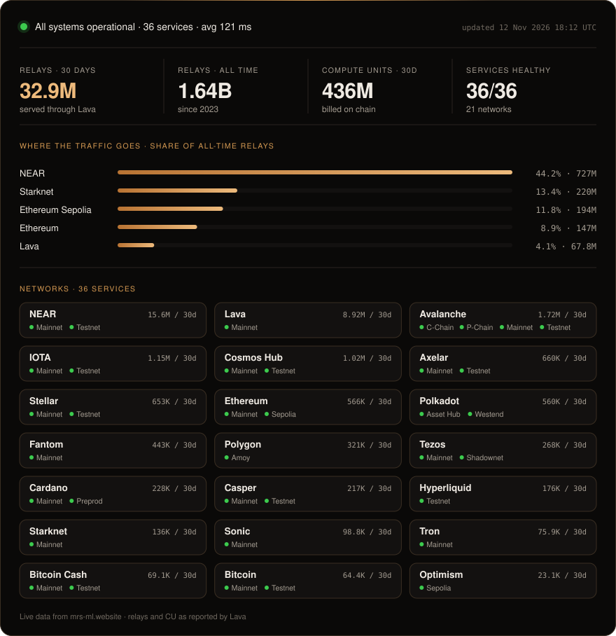

<p align="center">
  <a href="https://mrs-ml.website"></a>
</p>

<p align="center">
  Independent validator and RPC provider on the <b>Lava Network</b> since 2023.<br>
  Dedicated nodes from Ethereum and Starknet to NEAR, Cosmos and Bitcoin, mainnet and testnet.
</p>

<p align="center">
  <a href="https://mrs-ml.website"><b>mrs-ml.website</b></a>
  &nbsp;·&nbsp; <a href="https://mrs-ml.website/#delegate">Delegate</a>
  &nbsp;·&nbsp; <a href="https://info.lavanet.xyz/provider/lava@1gvwswcf0u3hfuxvlsvq88r90587t7snk20q0w3">Lava Info</a>
  &nbsp;·&nbsp; <a href="https://twitter.com/milakorn69">X</a>
</p>

<br>

<a href="https://mrs-ml.website/#networks"></a>

<sub>The card above is redrawn every 6 hours from the same data the website uses. Nothing on it is typed by hand.</sub>

## Tools

Small, single-purpose tools I run for my own infrastructure and publish as they are.

- **[release-watch](https://github.com/milakorn69/release-watch)** watches node releases and on-chain upgrade plans and sends a Telegram alert before an upgrade height arrives.
- **[lava-stake-watch](https://github.com/milakorn69/lava-stake-watch)** watches a Lava provider on chain and alerts on frozen and jailed chains, endpoint changes, delegations in and out, and new chain specs, with a daily rewards report.

## Delegate LAVA

Delegations go to the provider address below. Rewards follow the RPC traffic the provider serves, so the card above is the best picture of what a delegation earns from.

```text
lava@1gvwswcf0u3hfuxvlsvq88r90587t7snk20q0w3
```

Step-by-step instructions are on [mrs-ml.website/#delegate](https://mrs-ml.website/#delegate).

## How it runs

Servers at Hetzner in Germany, running Debian with Proxmox, LXC containers and Docker. Prometheus and Grafana watch the nodes around the clock, alerts go to Telegram, and release-watch flags upgrades before they land.

